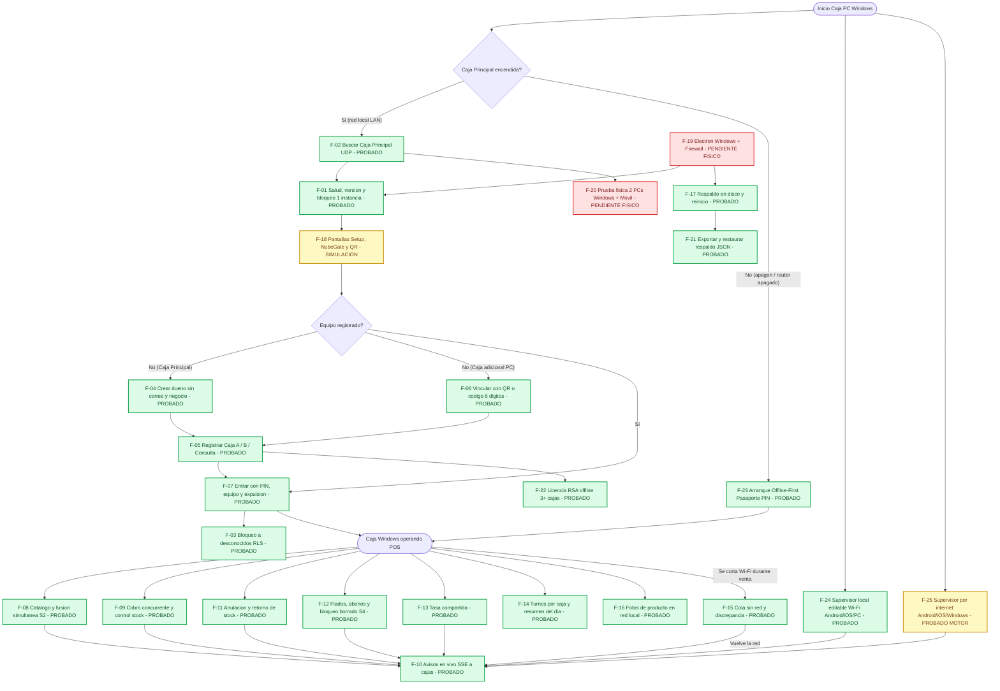

# Mapa de Flujos y Estado de Producción — Precios al Día LAN

> Verificación automatizada ejecutada con `bun run test:lan`, `bun run test:nube`, `bun run typecheck`, `bun run build` y `node scripts/nube/check-no-legacy-supabase.mjs dist`.

## Leyenda de estado

- **Verde (`PROBADO · PASA`):** Probado con ejecución real contra servidor HTTP + base Postgres local (`PGlite`) + eventos SSE en vivo. Listo a nivel de motor e integración para producción.
- **Amarillo (`PROBADO EN SIMULACIÓN`):** Probado en pantalla simulada (**JSDOM**) contra servidor HTTP/Postgres real o puente simulado; requiere validación visual o despliegue final en equipo físico.
- **Rojo (`PENDIENTE FISICO`):** Depende de hardware Windows real, dependencias de empaquetado Electron (`desktop/node_modules`), router Wi-Fi físico o despliegue SQL en Supabase para internet.

---

## Diagrama general de flujos

---

## Tabla de control para producción

| ID | Flujo | Prueba ejecutada | Estado | ¿Pasa a producción? |
|---|---|---|---|---|
| **F-01** | Chequeo de salud, versión y bloqueo de instancia | `lanMulticaja.test.js`, `lanFlujosCompletos.test.js`, `desktop/main.js` | 🟢 **Probado** | **Sí (motor)** |
| **F-02** | Descubrimiento UDP automático en la red local | `lanFlujosCompletos.test.js` | 🟢 **Probado** | **Sí (motor)** · validar router físico (F-20) |
| **F-03** | Bloqueo de lecturas/RPC sin sesión (RLS) | `lanMulticaja.test.js`, `lanFlujosCompletos.test.js` | 🟢 **Probado** | **Sí** |
| **F-04** | Cuenta del dueño offline, clave y negocio | `lanFlujosCompletos.test.js`, `lanUiFlujos.test.jsx` | 🟢 **Probado** | **Sí** |
| **F-05** | Registro `#A`, `#B`, consulta y límite 2 cajas | `lanMulticaja.test.js`, `lanFlujosCompletos.test.js` | 🟢 **Probado** | **Sí** |
| **F-06** | QR y código temporal de 6 dígitos (1 solo uso) | `lanMulticaja.test.js`, `lanFlujosCompletos.test.js`, `lanUiFlujos.test.jsx` | 🟢 **Probado** | **Sí** |
| **F-07** | Gestión de cajeros, PIN y expulsión de caja | `lanFlujosCompletos.test.js` | 🟢 **Probado** | **Sí** |
| **F-08** | Catálogo y fusión por campo S2 | `lanFlujosCompletos.test.js` | 🟢 **Probado** | **Sí** |
| **F-09** | Ventas simultáneas y rechazo sin stock | `lanMulticaja.test.js`, `lanFlujosCompletos.test.js` | 🟢 **Probado** | **Sí** |
| **F-10** | Sincronización instantánea SSE entre cajas y Supervisor | `lanMulticaja.test.js`, `lanFlujosCompletos.test.js`, `lanCloudBridgeRelay.test.js` | 🟢 **Probado** | **Sí** |
| **F-11** | Anulación de venta y retorno de stock | `lanFlujosCompletos.test.js`, `lanSupervisorActions.test.jsx` | 🟢 **Probado** | **Sí** |
| **F-12** | Fiados/abonos entre cajas y bloqueo borrado S4 | `lanMulticaja.test.js`, `lanFlujosCompletos.test.js`, `lanSupervisorActions.test.jsx` | 🟢 **Probado** | **Sí** |
| **F-13** | Tasa compartida (`pdn_rate_v1`) con permiso | `lanFlujosCompletos.test.js`, `lanSupervisorActions.test.jsx` | 🟢 **Probado** | **Sí** |
| **F-14** | Turnos por caja y consolidado `cash_day_summary` | `lanFlujosCompletos.test.js` | 🟢 **Probado** | **Sí** |
| **F-15** | Corte de red LAN, cola y discrepancia | `lanFlujosCompletos.test.js` | 🟢 **Probado** | **Sí** |
| **F-16** | Subida y carga local de fotos (`/lan/images`) | `lanMulticaja.test.js` | 🟢 **Probado** | **Sí** |
| **F-17** | Respaldo JSON en disco y reinicio de servidor | `lanMulticaja.test.js` | 🟢 **Probado** | **Sí** |
| **F-18** | Flujo visual React (`LanSetupScreen`, `NubeGate`, QR, login web remoto) | `lanUiFlujos.test.jsx` (JSDOM + HTTP/PGlite real) | 🟡 **Simulación** | Validar visualmente en navegador real |
| **F-19** | Ventana Electron real Windows (`desktop:build`) y firewall | Script `scripts/lan/windows-firewall-rule.ps1` listo; falta `desktop/node_modules` y arranque Windows | 🔴 **Pendiente físico** | **Requerido antes de instalar en PCs** |
| **F-20** | Prueba física entre 2 PCs Windows + Android/iOS en router | *Sin prueba de hardware físico todavía* | 🔴 **Pendiente físico** | **Requerido en local** |
| **F-21** | Exportar y restaurar respaldo JSON + invariantes | `lanRestoreAndLicense.test.js` | 🟢 **Probado** | **Sí** |
| **F-22** | Activación de licencia RSA offline (>2 cajas) y rechazo de falsificación | `lanRestoreAndLicense.test.js` | 🟢 **Probado** | **Sí** |
| **F-23** | Arranque 100% Offline-First sin Caja Principal + Pasaporte PIN 72 h + bloqueo 5 fallos | `offlinePassport.test.js`, `lanOfflineBoot.test.jsx` | 🟢 **Probado** | **Sí** |
| **F-24** | Modo Supervisor editable dentro del local (web SPA en `dist/` + UUID HTTP + productos, stock multi-sede, tasa, anulación, abonos) | `lanStaticServe.test.js`, `safeUuid.test.js`, `lanSupervisorActions.test.jsx` | 🟢 **Probado** | **Sí** |
| **F-25** | Modo Supervisor por internet (Android, iOS, Windows ↔ Puente Supabase Relay + Caja Principal `cloudBridge.mjs`) | `lanCloudBridgeSql.test.js`, `lanCloudBridgeRelay.test.js` (PGlite + Relay SQL) | 🟡 **Probado en motor** | Desplegar `supabase/lan/001_puente_supervisor.sql` en Supabase y probar con 4G real |
